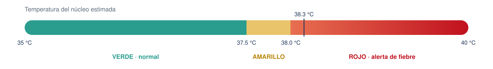

  

 

## Qué es ThermoCare

ThermoCare es un **parche que se pega en el antebrazo** de una persona que recibe quimioterapia. Mide su temperatura todo el día, sin que tenga que hacer nada, y **si aparece fiebre avisa al momento** al celular de su familia y a la pantalla de enfermería.

No mide solo la piel: calcula la temperatura **del interior del cuerpo**, que es la que de verdad importa.

 

  

 

## Por qué importa

La quimioterapia baja las defensas. En ese estado, **una fiebre puede ser la primera señal de una infección grave** que hay que atender en menos de una hora. Hoy la temperatura se toma solo unas cuantas veces al día, y algunas medicinas, como el paracetamol, pueden esconderla entre una toma y otra.

<table>
<tr>
<td align="center" width="33%"><h2>207,154</h2>personas recibieron un diagnóstico de cáncer en México en 2022</td>
<td align="center" width="33%"><h2>14.7 millones</h2>de médicos, enfermeras y otros profesionales de la salud faltan en el mundo</td>
<td align="center" width="33%"><h2>1 hora</h2>es el tiempo para atender una fiebre en quimioterapia</td>
</tr>
</table>

 

  

 

## La luz del parche

El parche tiene una luz que cambia de color, para que el paciente sepa cómo va sin ver ninguna pantalla.

  

| Color | Qué significa | Qué pasa |
| :-- | :-- | :-- |
| **Verde** | Temperatura normal | ThermoCare sigue vigilando |
| **Amarillo** | Empieza a subir (37.5 a 37.9 °C) | Enfermería lo ve marcado en su pantalla |
| **Rojo** | Fiebre (38 °C o más) | La familia y enfermería reciben el aviso |

Si el parche se despega, no da una falsa alarma: pide que lo vuelvan a colocar.

 

## Para quién es

<table>
<tr>
<td width="25%" valign="top">

**La persona en tratamiento**

Lleva el parche y sigue con su día. No tiene que acordarse de tomarse la temperatura.

</td>
<td width="25%" valign="top">

**Su familia**

Recibe un mensaje en el celular si hay fiebre, aunque no esté en la misma casa.

</td>
<td width="25%" valign="top">

**Enfermería**

Ve a todos sus pacientes en una pantalla y sabe a quién atender primero.

</td>
<td width="25%" valign="top">

**El médico**

Consulta cómo cambió la temperatura durante el día y qué medicinas tomó.

</td>
</tr>
</table>

 

## Cómo sabe la temperatura de adentro

La piel engaña: si el cuarto está frío, se enfría aunque por dentro haya fiebre. ThermoCare resuelve esto con un truco: **manda una tibieza muy suave hacia la piel y "escucha" cómo regresa**. Dependiendo de qué tan rápido y qué tan fuerte llega, sabe cuánto calor viene del interior del cuerpo.

  

 

## Preguntas frecuentes

<b>¿El parche quema o se siente caliente?</b>

 
No. La tibieza es muy pequeña y dura poco. Además tiene dos protecciones que lo apagan solas: una en el programa y otra física, que corta la corriente si llega a 40 °C.

<b>¿Lo puede usar alguien con marcapasos?</b>

 
Está pensado para eso: no usa el ritmo del corazón, que es lo que suelen medir otros dispositivos, y se coloca en el antebrazo, lejos del implante. Aun así, es un prototipo y todavía no se ha probado en personas con marcapasos.

<b>¿Qué pasa si el parche se despega?</b>

 
ThermoCare lo detecta, deja de usar esa lectura y avisa que hay que volver a colocarlo. Así no manda una alarma de fiebre falsa.

<b>¿Necesita internet?</b>

 
Sí, se conecta por WiFi para mandar las lecturas y los avisos. La luz del parche sigue mostrando el color aunque nadie esté viendo una pantalla.

<b>¿Reemplaza al médico o al termómetro?</b>

 
No. Es una ayuda para darse cuenta antes de que algo cambia. Las decisiones siempre las toma el equipo médico.

<b>¿Quién ve mis datos?</b>

 
Está diseñado para que solo los vean el personal médico que atiende al paciente y los familiares que él autorice, y cada aviso llega únicamente a ellos. El acceso con usuario y contraseña está en desarrollo.

 

## Hacia dónde va

| Ya funciona | Lo siguiente | Más adelante |
| :-- | :-- | :-- |
| Medir y mandar la temperatura a internet | Calcular la temperatura de adentro con la onda | Anticipar la fiebre una o dos horas antes |
| Luz de color y aviso de parche despegado | Mensajes a la familia por Telegram | Acceso con usuario y contraseña |
| Guardar todo el historial | Pantalla para enfermería | Mapa de temperatura de todo el cuerpo en 3D |

 

## Quiénes lo hacemos

<table>
<tr>
<td align="center" width="20%"><b>Federico Salazar</b></td>
<td align="center" width="20%"><b>José Ángel López</b></td>
<td align="center" width="20%"><b>Antonio Gómez</b></td>
<td align="center" width="20%"><b>Francisco González</b></td>
<td align="center" width="20%"><b>Raúl Anguiano</b></td>
</tr>
</table>

Estudiantes del Tecnológico de Monterrey · Implementación de internet en las cosas · Grupo 504 Con la guía de los profesores Enrique Gonzales Guerrero y Jesús Carlos Morón García

¿Te interesan los detalles técnicos? Están en la carpeta <a href="docs/">docs</a>.

 

> [!IMPORTANT]
> ThermoCare es un **prototipo en desarrollo**, no un dispositivo médico aprobado. Por ahora solo se prueba con integrantes del equipo sanos y sin implantes, nunca con pacientes.
