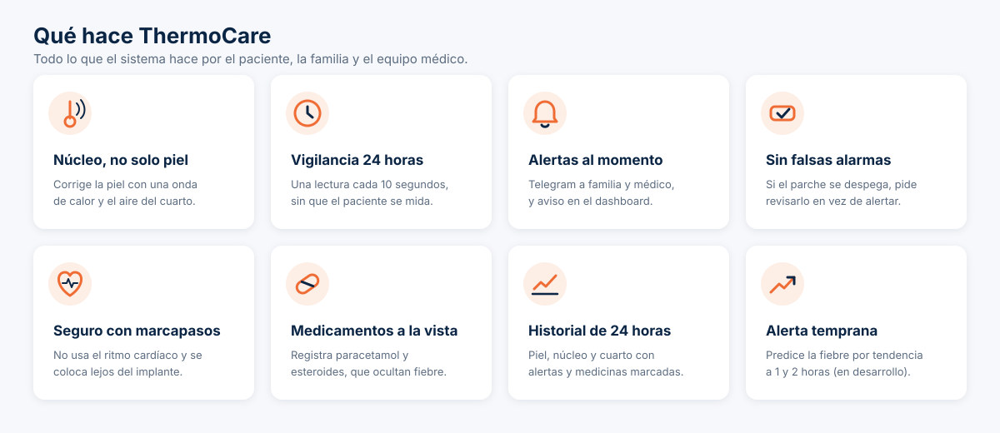
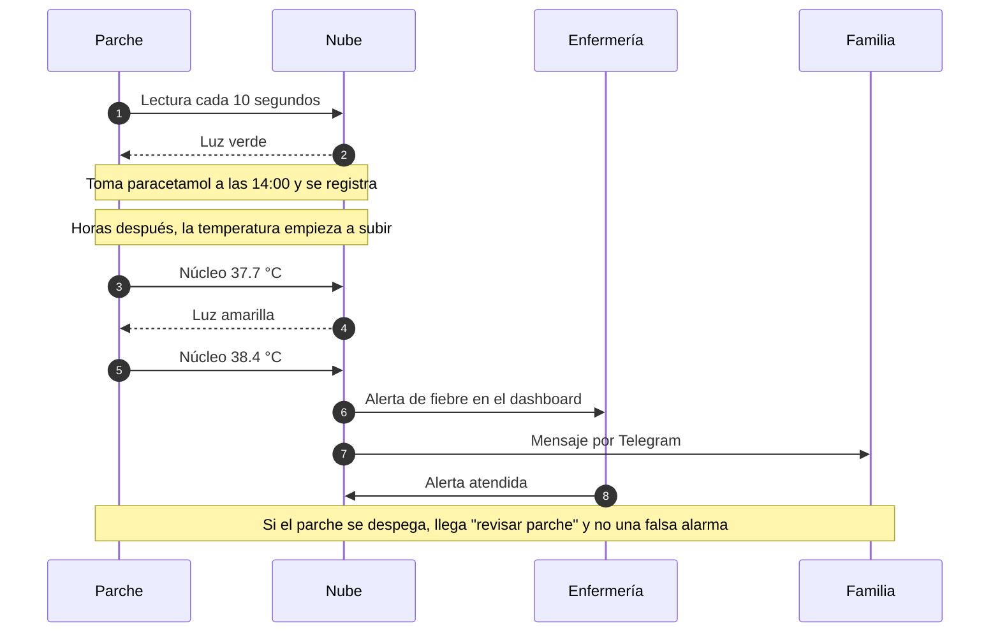
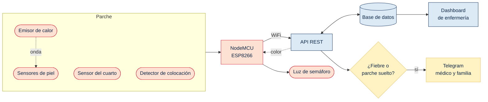
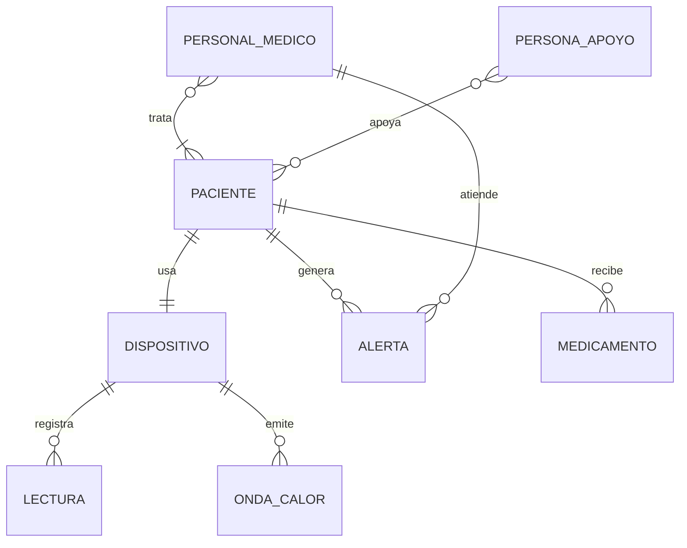

<p align="center">
  
</p>

<p align="center">
  <a href="https://github.com/users/Fedlui/projects/6"></a>
  <a href="docs/"></a>
  
  
  
</p>

<br>

## Por qué existe

Durante la quimioterapia las defensas bajan y **una fiebre puede ser la primera señal de una infección grave**, la neutropenia febril, que necesita atención en menos de una hora. Pero la temperatura se toma solo unas pocas veces al día, y el paracetamol o los esteroides pueden ocultarla entre una toma y otra.

<table>
<tr>
<td align="center" width="33%"><h2>207,154</h2><sub>casos nuevos de cáncer en México en 2022 (GLOBOCAN)</sub></td>
<td align="center" width="33%"><h2>14.7 millones</h2><sub>profesionales de la salud que faltan en el mundo para vigilar a cada paciente</sub></td>
<td align="center" width="33%"><h2>&lt; 1 hora</h2><sub>para atender una neutropenia febril</sub></td>
</tr>
</table>

**ThermoCare** es un parche que se coloca en el antebrazo y vigila la temperatura **del interior del cuerpo** todo el día. Si aparece fiebre, avisa al momento a enfermería, al médico y a la familia.

<br>

<p align="center">
  
</p>

<br>

## Para quién

<table>
<tr>
<td width="25%" valign="top">

**Paciente**

Lleva el parche y ve en su luz de color si todo va bien. No tiene que acordarse de medirse, y si usa marcapasos el parche no lo afecta.

</td>
<td width="25%" valign="top">

**Enfermería**

Ve a todos sus pacientes en una sola pantalla, ordenados por riesgo, y recibe la alerta en tiempo real.

</td>
<td width="25%" valign="top">

**Médico**

Revisa la gráfica de 24 horas de cada paciente, con los medicamentos y las alertas marcados.

</td>
<td width="25%" valign="top">

**Familia**

Recibe el aviso de fiebre en su celular por Telegram, con la temperatura y la hora.

</td>
</tr>
</table>

<br>

## Un día con ThermoCare



<br>

## El semáforo

<p align="center">
  
</p>

| Luz | Núcleo | Qué hace el sistema |
| :-- | :-- | :-- |
| **Verde** | menos de 37.5 °C | Sigue vigilando |
| **Amarillo** | 37.5 a 37.9 °C | Marca precaución en el dashboard |
| **Rojo** | 38.0 °C o más | Crea la alerta y avisa por Telegram |
| **Revisar parche** | entra luz bajo el parche | No usa la lectura y pide volver a colocarlo |

La alarma clínica de neutropenia febril se dispara con **38.3 °C una vez** o **38.0 °C sostenidos durante una hora**. Para no saturar al personal, una alerta igual no se repite mientras haya otra sin atender de los últimos 5 minutos.

<br>

## En números

<table>
<tr>
<td align="center"><h3>10 s</h3><sub>entre lecturas</sub></td>
<td align="center"><h3>8,640</h3><sub>lecturas al día por parche</sub></td>
<td align="center"><h3>0.05 °C</h3><sub>resolución de los sensores</sub></td>
<td align="center"><h3>&lt; 1 min</h3><sub>de la fiebre al aviso</sub></td>
<td align="center"><h3>2</h3><sub>cortes de seguridad del calentador</sub></td>
</tr>
</table>

<br>

## Cómo lo logra

La piel no dice la temperatura real del cuerpo: depende del aire del cuarto y de cuánta grasa hay debajo. Por eso el parche **analiza la temperatura como una red con ondas**: un calentador diminuto manda una onda de calor muy suave y dos sensores la escuchan a 4 y 8 mm. Con lo que tarda y lo que se debilita, el sistema corrige la piel y calcula el núcleo.

<p align="center">
  
</p>

```
T_núcleo = T_piel + K · (T_piel − T_cuarto)
```

**K** sale del análisis de la onda de cada persona. Con un modelo térmico del cuerpo, esa lectura del brazo se extiende a un mapa de temperatura de todo el cuerpo.

<br>

## Lo que el sistema puede responder

Los datos guardados contestan las preguntas que importan al equipo médico:

<table>
<tr>
<td width="33%" valign="top">

**¿Cómo cambió su temperatura hoy?**

Promedio, máxima y mínima del núcleo por cada hora de las últimas 24, con el color del semáforo. Muestra cuándo empezó y terminó una fiebre.

</td>
<td width="33%" valign="top">

**¿Quién necesita atención?**

Alertas de cada paciente por tipo, cuántas siguen pendientes y qué porcentaje ya se atendió.

</td>
<td width="33%" valign="top">

**¿El parche está funcionando?**

Porcentaje de lecturas con el parche bien puesto y minutos que lleva cada dispositivo sin mandar datos.

</td>
</tr>
</table>

<br>

## Arquitectura



| Capa | Tecnología |
| :-- | :-- |
| Parche | NodeMCU ESP8266 · 3 termistores NTC 10k · convertidor ADS1115 de 16 bits · fotorresistencia · calentador con MOSFET · termostato de 40 °C · LED RGB |
| Nube | API REST en Node.js con Express · MySQL 8 |
| Avisos | Bot de Telegram |
| Pantallas | Dashboard de enfermería · modelo 3D y radar térmico del paciente |
| Seguimiento | GitHub Projects con Scrum en sprints de una semana |

<br>

## Cómo se guarda la información



Cada lectura queda ligada a su parche y a su hora; cada onda de calor, a su inicio, fin y potencia; cada alerta, al paciente y a quien la atendió. Los médicos y familiares solo reciben los avisos de los pacientes que tienen asignados.

<br>

## Hacia dónde va

| Ahora | Siguiente | Después |
| :-- | :-- | :-- |
| Lectura continua y envío a la nube | Análisis de ondas y temperatura del núcleo | Alerta temprana por tendencia, a 1 y 2 horas |
| Semáforo y aviso de parche despegado | Alarma de neutropenia febril | Inicio de sesión para proteger los datos |
| Base de datos y API | Dashboard de enfermería y Telegram | Modelo 3D y mapa térmico de todo el cuerpo |

El avance al día está en el [tablero del proyecto](https://github.com/users/Fedlui/projects/6).

<br>

## Repositorio

```
TermoCare/
├── assets/     Imágenes de este README
├── docs/       Documentación de cada etapa
├── sql/        Base de datos, datos de prueba e indicadores
├── api/        API REST
└── arduino/    Código del parche
```

<br>

## Equipo

<table>
<tr>
<td align="center" width="20%"><b>Federico Salazar</b><br><sub>Product Owner</sub><br><sub>Datos</sub></td>
<td align="center" width="20%"><b>José Ángel López</b><br><sub>Scrum Master</sub><br><sub>Calidad y seguridad</sub></td>
<td align="center" width="20%"><b>Antonio Gómez</b><br><sub>Hardware</sub><br><sub>y experimento</sub></td>
<td align="center" width="20%"><b>Francisco González</b><br><sub>Actuadores</sub><br><sub>y alertas</sub></td>
<td align="center" width="20%"><b>Raúl Anguiano</b><br><sub>Dashboard</sub><br><sub>y algoritmo</sub></td>
</tr>
</table>

<p align="center"><sub>Implementación de internet en las cosas · Grupo 504 · Tecnológico de Monterrey<br>Profesores Enrique Gonzales Guerrero y Jesús Carlos Morón García</sub></p>

<br>

## Seguridad

> [!WARNING]
> ThermoCare es un **prototipo escolar**, no un dispositivo médico.
> - Las pruebas se hacen solo con un integrante sano, **sin marcapasos ni implantes**. Nunca con pacientes.
> - El parche funciona **solo con power bank**, nunca conectado a la laptop o al cargador mientras se usa.
> - El calentador tiene doble corte: por software y por un termostato de 40 °C.
