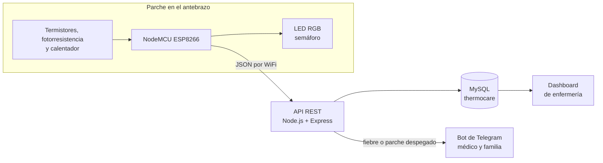
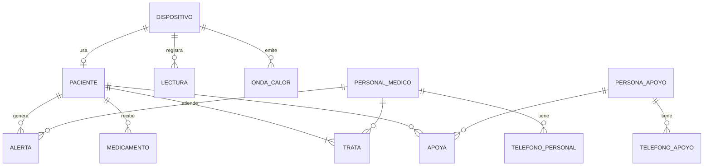

# 🌡️ ThermoCare IoT

**Parche de antebrazo que vigila la temperatura del núcleo del cuerpo de pacientes en quimioterapia y avisa de la fiebre antes de que sea tarde.**

Implementación de internet en las cosas · Grupo 504 · Equipo 5 · Tecnológico de Monterrey

[📋 Tablero Kanban](https://github.com/users/Fedlui/projects/6) · [🗓️ Sprints](../../milestones) · [✅ Backlog](../../issues?q=is%3Aissue) · [📄 Diseño de la base de datos](docs/Etapa2-Software-Equipo5.pdf)

---

## 🩺 El problema

Durante la quimioterapia las defensas bajan y **la fiebre puede ser la primera señal de una infección grave** (neutropenia febril), que necesita atención en menos de una hora. Hoy la temperatura se toma pocas veces al día y el paracetamol o los esteroides pueden ocultarla entre una toma y otra. Solo en México hubo **207,154 casos nuevos de cáncer en 2022** (GLOBOCAN).

Muchos de estos pacientes usan **marcapasos**, así que el sistema no usa el ritmo cardíaco y no debe interferir con dispositivos implantados.

## 💡 La solución

ThermoCare analiza la temperatura **como una red con ondas**: un calentador muy pequeño en el parche es el **emisor** y dos termistores a **4 mm y 8 mm** son los **receptores**. Con la atenuación y el retraso de la onda de calor entre ambos se corrige la lectura de la piel y se estima la temperatura del núcleo.

```
T_núcleo = T_piel + K · (T_piel − T_cuarto)
```

Hoy la API usa **K = 0.28**; el objetivo es calcular K con el análisis de ondas de cada paciente.

## 🏗️ Cómo funciona



1. El **NodeMCU** lee los sensores y manda una lectura cada 10 segundos a la API.
2. La **API** revisa los datos, calcula el núcleo, guarda la lectura en MySQL y responde el color del semáforo.
3. Si hay **fiebre** o el **parche se despegó**, crea una alerta y avisa por **Telegram** al médico y a la familia.
4. El **dashboard** muestra a todos los pacientes y su gráfica de 24 h.

## 🚦 Semáforo y alertas

| Color | Temperatura del núcleo | Qué pasa |
| --- | --- | --- |
| 🟢 Verde | menos de 37.5 °C | Normal |
| 🟡 Amarillo | 37.5 a 37.9 °C | Precaución |
| 🔴 Rojo | 38.0 °C o más | Alerta de fiebre por Telegram |
| ⚪ Revisar parche | entra luz bajo el parche | La lectura no se usa para fiebre |

Meta para el Sprint 3: alarma de neutropenia febril con **38.3 °C una vez o 38.0 °C sostenidos 1 hora**.

## 🔌 Hardware

| Componente | Función | Estado |
| --- | --- | --- |
| NodeMCU ESP8266 | Lee sensores y envía por WiFi | ✅ |
| 2 termistores NTC 10k β3950 (4 y 8 mm) | Receptores de la onda en la piel | 🟠 En progreso |
| Termistor NTC del cuarto | Temperatura del aire | 🟠 En progreso |
| Convertidor ADS1115 (16 bits) | Lee los termistores con precisión | 🟠 En progreso |
| Fotorresistencia | Detecta si el parche está pegado | ✅ |
| Resistencia calentadora + MOSFET IRLZ44N | Emite la onda de calor | 🟠 En progreso |
| Termostato KSD9700 40 °C | Corte de seguridad del calentador | 🟠 En progreso |
| LED RGB | Semáforo local | ✅ |

Mientras llegan los sensores definitivos, el circuito usa los del kit (DHT11 y PIR) con el **mismo formato de datos**, así que la API y la base de datos no cambian.

## 🗄️ Base de datos

MySQL 8.0 (InnoDB), base `thermocare`, 12 tablas en 3NF.



El modelo Chen, el relacional, la normalización y el diccionario de datos están en [`docs/Etapa2-Software-Equipo5.pdf`](docs/Etapa2-Software-Equipo5.pdf).

## 🔗 API REST

Puerto `3000`. Las rutas usan el número del dispositivo, paciente o alerta.

| Método | Ruta | Quién la usa | Qué hace |
| --- | --- | --- | --- |
| `GET` | `/` | Pruebas | Confirma que la API está encendida |
| `POST` | `/lecturas` | NodeMCU | Guarda una lectura, revisa alertas y regresa el semáforo |
| `GET` | `/lecturas` | Consulta | Últimas lecturas con dispositivo y paciente |
| `GET` | `/dispositivos/:id/estado` | NodeMCU | Color del semáforo y cada cuánto mandar datos |
| `GET` | `/pacientes/:id/temperatura` | Dashboard | Núcleo actual y si va subiendo o bajando |
| `GET` | `/alertas` | Dashboard y bot | Alertas, o solo las activas |
| `PUT` | `/alertas/:id/atender` | Personal médico | Marca una alerta como atendida |

Lo que manda el NodeMCU:

```json
{
  "id_dispositivo": 1,
  "temp_piel": 34.1,
  "temp_flujo": 33.6,
  "temp_cuarto": 24.0,
  "parche_colocado": 1,
  "calentador_encendido": 0
}
```

Respuestas: `201` guardada · `200` consulta · `400` datos mal · `404` no existe · `500` falla al guardar · `503` MySQL apagado.

## 📁 Repositorio

```
TermoCare/
├── docs/       Entregables de cada etapa (PDF)
├── sql/        Script de creación, datos de prueba e indicadores
├── api/        API REST en Node.js (Express + mysql2)
└── arduino/    Código del NodeMCU
```

### Correr el proyecto

1. **Base de datos:** abre XAMPP, inicia MySQL y ejecuta `sql/ScriptCreacionBaseDatos_iot_Equipo5.sql`.
2. **API:** en `api/` corre `npm install` y luego `node RestApi-<matrícula>.js`. Configura MySQL, límites y token de Telegram en `config.js`.
3. **NodeMCU:** abre el `.ino` de `arduino/` en Arduino IDE (placa *NodeMCU 1.0*), escribe tu WiFi y la IP de tu computadora, y súbelo. Monitor serial a 115200.

## 🗓️ Plan

| Sprint | Fechas | Objetivo | Estado |
| --- | --- | --- | --- |
| 0 | 26 – 30 oct | Tablero, repositorio y base de datos | ✅ |
| 1 | 2 – 6 nov | Lectura de sensores y LEDs | 🟠 |
| 2 | 9 – 13 nov | Calentador, envío a la nube y diseño de la BD | 🟠 |
| 3 | 16 – 20 nov | Análisis de ondas, núcleo y alarma de fiebre | ⚪ |
| 4 | 23 – 27 nov | Dashboard y alertas por Telegram | ⚪ |
| 5 | 30 nov – 4 dic | Inicio de sesión, alerta temprana, 3D y expo | ⚪ |

El detalle de cada historia está en el [tablero](https://github.com/users/Fedlui/projects/6) y en los [issues](../../issues?q=is%3Aissue).

## 👥 Equipo

| Integrante | Matrícula | Rol |
| --- | --- | --- |
| Federico Luis Salazar Guzmán | A01174886 | Product Owner · datos |
| José Ángel López Arvayo | A00843562 | Scrum Master · calidad y seguridad |
| Antonio Daniel Gómez García | A01199791 | Hardware y experimento |
| Francisco González Brito | A00841560 | Actuadores, alertas y Telegram |
| Raúl Alejandro Anguiano Solano | A01742895 | Dashboard y algoritmo de ondas |

**Profesores:** Enrique Gonzales Guerrero y Jesús Carlos Morón García.

## ⚠️ Seguridad

- Las pruebas con el parche se hacen **solo con un integrante sano, sin marcapasos ni implantes**. Nunca con pacientes.
- El parche se alimenta **solo con power bank**, nunca conectado a la laptop o al cargador mientras se usa.
- El calentador tiene doble corte: por software a 38.5 °C en la piel y por el termostato KSD9700 a 40 °C.
- Es un prototipo escolar, **no es un dispositivo médico**.
