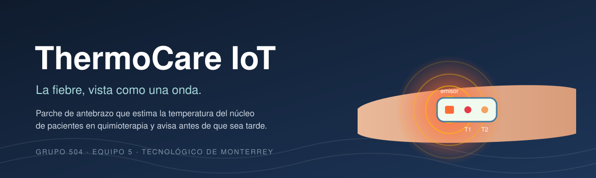
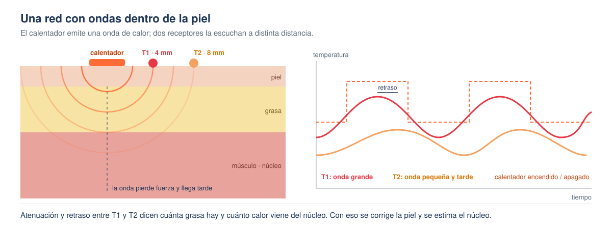
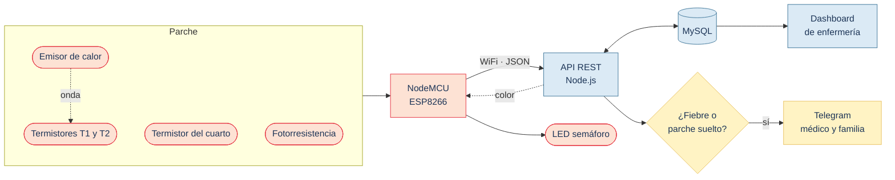
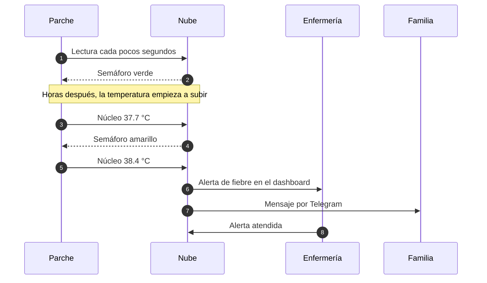
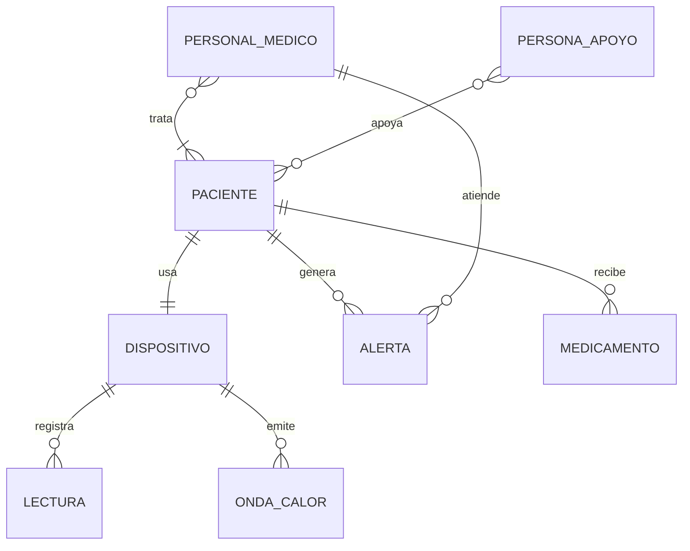

<p align="center">
  
</p>

<p align="center">
  <a href="https://github.com/users/Fedlui/projects/6"></a>
  <a href="../../issues?q=is%3Aissue"></a>
  
  
  
</p>

<br>

> **Durante la quimioterapia, una fiebre puede ser la primera señal de una infección grave que necesita atención en menos de una hora.**
> Hoy la temperatura se toma pocas veces al día. ThermoCare la vigila todo el tiempo.

<br>

<p align="center">
  
</p>

<br>

## La idea en una frase

Un parche en el antebrazo **envía una pequeña onda de calor hacia la piel y escucha cómo regresa**. Con lo que tarda y lo que se debilita, calcula la temperatura del interior del cuerpo, no solo la de la piel.

<p align="center">
  
</p>

| | Emisor | Receptor 1 | Receptor 2 | Referencia |
| :-- | :-- | :-- | :-- | :-- |
| **Qué es** | Calentador diminuto | Termistor a 4 mm | Termistor a 8 mm | Termistor del cuarto |
| **Qué hace** | Prende y apaga en ciclos | Recibe la onda fuerte | Recibe la onda débil y tarde | Mide el aire alrededor |
| **Qué aporta** | La señal conocida | La temperatura de la piel | El retraso y la atenuación | La pérdida de calor al ambiente |

Con esos datos se aplica:

```
T_núcleo = T_piel + K · (T_piel − T_cuarto)
```

donde **K** sale del análisis de la onda: cuánta grasa hay bajo el parche y cuánto calor sube desde el núcleo. Con un modelo térmico del cuerpo, esa lectura del brazo se extiende a un mapa de temperatura de todo el cuerpo.

<br>

## Del parche al celular del médico



<br>

## Un día con ThermoCare



<br>

## El semáforo

<p align="center">
  
</p>

La alarma clínica de **neutropenia febril** se dispara con **38.3 °C una vez** o **38.0 °C sostenidos durante una hora**. Si entra luz bajo el parche, la lectura no se usa y el sistema pide **revisar el parche** en lugar de dar una falsa alarma.

<br>

## Quién lo usa

<table>
<tr>
<td width="25%" valign="top">

**Paciente**

Lleva el parche y ve en el LED si todo va bien. No tiene que acordarse de medirse.

</td>
<td width="25%" valign="top">

**Enfermería**

Ve a todos sus pacientes en una pantalla y recibe la alerta en tiempo real.

</td>
<td width="25%" valign="top">

**Médico**

Revisa la gráfica de 24 horas con medicamentos y alertas marcados.

</td>
<td width="25%" valign="top">

**Familia**

Recibe el aviso de fiebre en su celular por Telegram.

</td>
</tr>
</table>

<br>

## Lo que hay adentro

<table>
<tr>
<th>Sentir</th><th>Pensar</th><th>Avisar</th>
</tr>
<tr>
<td valign="top">

- 3 termistores NTC 10k β3950
- Convertidor ADS1115 de 16 bits
- Fotorresistencia para saber si el parche está pegado

</td>
<td valign="top">

- NodeMCU ESP8266 con WiFi
- API REST en Node.js
- Base de datos MySQL
- Cálculo del núcleo con análisis de ondas

</td>
<td valign="top">

- Calentador con MOSFET (la onda)
- LED RGB de semáforo
- Bot de Telegram
- Dashboard de enfermería

</td>
</tr>
</table>

<br>

## Cómo se guarda la información



Cada lectura queda ligada a su parche y a su hora; cada onda de calor, a su inicio, fin y potencia; cada alerta, al paciente y a quien la atendió. El diseño completo está en [`docs/`](docs/).

<br>

## El repositorio

```
TermoCare/
├── assets/     Imágenes de este README
├── docs/       Documentación y entregables
├── sql/        Creación de la base de datos, datos de prueba e indicadores
├── api/        API REST en Node.js
└── arduino/    Código del parche (NodeMCU)
```

<br>

## Equipo

<table>
<tr>
<td align="center" width="20%"><b>Federico Salazar</b><br><sub>Product Owner</sub><br><sub>Datos</sub></td>
<td align="center" width="20%"><b>José Ángel López</b><br><sub>Scrum Master</sub><br><sub>Calidad y seguridad</sub></td>
<td align="center" width="20%"><b>Antonio Gómez</b><br><sub>Hardware</sub><br><sub>y experimento</sub></td>
<td align="center" width="20%"><b>Francisco González</b><br><sub>Actuadores</sub><br><sub>y alertas</sub></td>
<td align="center" width="20%"><b>Raúl Anguiano</b><br><sub>Dashboard</sub><br><sub>y algoritmo</sub></td>
</tr>
</table>

<p align="center"><sub>Implementación de internet en las cosas · Grupo 504 · Profesores Enrique Gonzales Guerrero y Jesús Carlos Morón García</sub></p>

<br>

## Seguridad

> [!WARNING]
> ThermoCare es un **prototipo escolar**, no un dispositivo médico.
> - Las pruebas se hacen solo con un integrante sano, **sin marcapasos ni implantes**. Nunca con pacientes.
> - El parche funciona **solo con power bank**, nunca conectado a la laptop o al cargador mientras se usa.
> - El calentador tiene doble corte de seguridad: por software y por un termostato de 40 °C.
> - El sistema no usa el ritmo cardíaco, para no depender de nada que pueda afectar un marcapasos.
