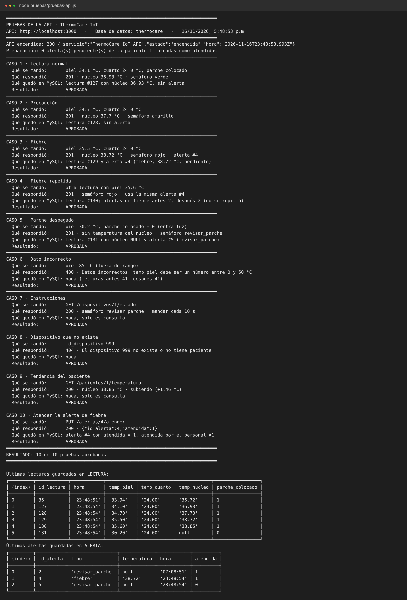

# Pruebas

`pruebas-api.js` manda a la API los casos de prueba del proyecto y revisa en MySQL qué quedó guardado.

| Caso | Qué se manda | Qué debe pasar |
| --- | --- | --- |
| 1 · Lectura normal | Piel 34.1 °C, cuarto 24 °C | 201, núcleo cerca de 36.9 °C, verde, sin alerta |
| 2 · Precaución | Piel 34.7 °C | 201, núcleo cerca de 37.7 °C, amarillo |
| 3 · Fiebre | Piel 35.5 °C | 201, núcleo cerca de 38.7 °C, rojo y alerta de fiebre |
| 4 · Fiebre repetida | Otra lectura con fiebre | 201, rojo, sin repetir la alerta |
| 5 · Parche despegado | Entra luz bajo el parche | 201, sin núcleo y alerta de revisar parche |
| 6 · Dato incorrecto | Piel 85 °C | 400 y no se guarda nada |
| 7 · Instrucciones | GET del estado del dispositivo | 200, mandar cada 10 segundos |
| 8 · Dispositivo inexistente | id 999 | 404 |
| 9 · Tendencia | GET de la temperatura del paciente | 200 y si sube o baja |
| 10 · Atender alerta | PUT de la alerta de fiebre | 200 y queda atendida |

## Cómo correrlas

1. Carga la base de datos (carpeta `sql`).
2. Enciende la API: `cd api && npm start`.
3. En otra terminal, desde la carpeta principal: `node pruebas/pruebas-api.js`.

## Salidas

En `salidas/` está el resultado de correrlas con el código de este repositorio (10 de 10 aprobadas):

| Archivo | Qué muestra |
| --- | --- |
| `captura-pruebas-api.png` · `salida-pruebas-api.txt` | Cada caso con lo que se mandó, lo que respondió la API y lo que quedó en MySQL |
| `captura-consola-api.png` · `salida-consola-api.txt` | Lo que escribe la API: cada petición con su hora y respuesta, y los avisos de Telegram |
| `captura-indicadores.png` · `salida-indicadores.txt` | El resultado de las 3 consultas de indicadores |

